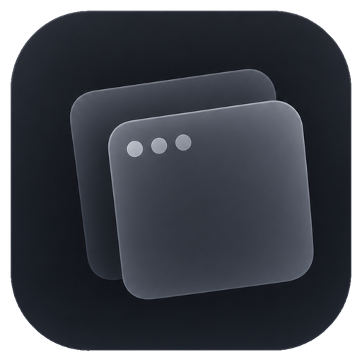
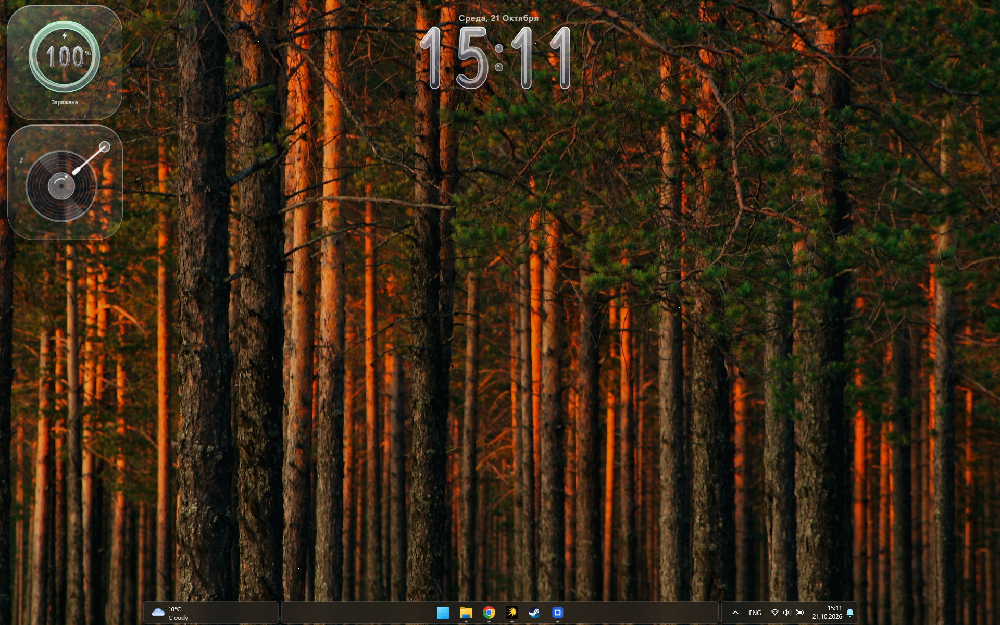
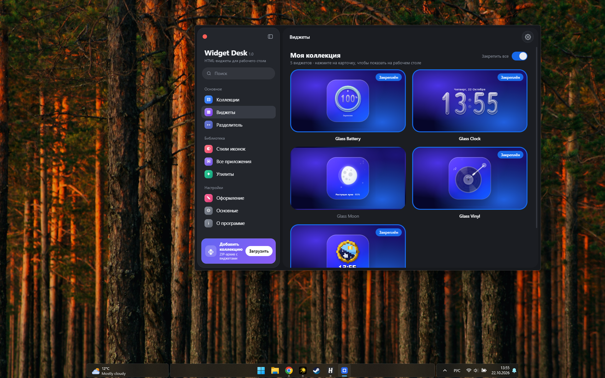
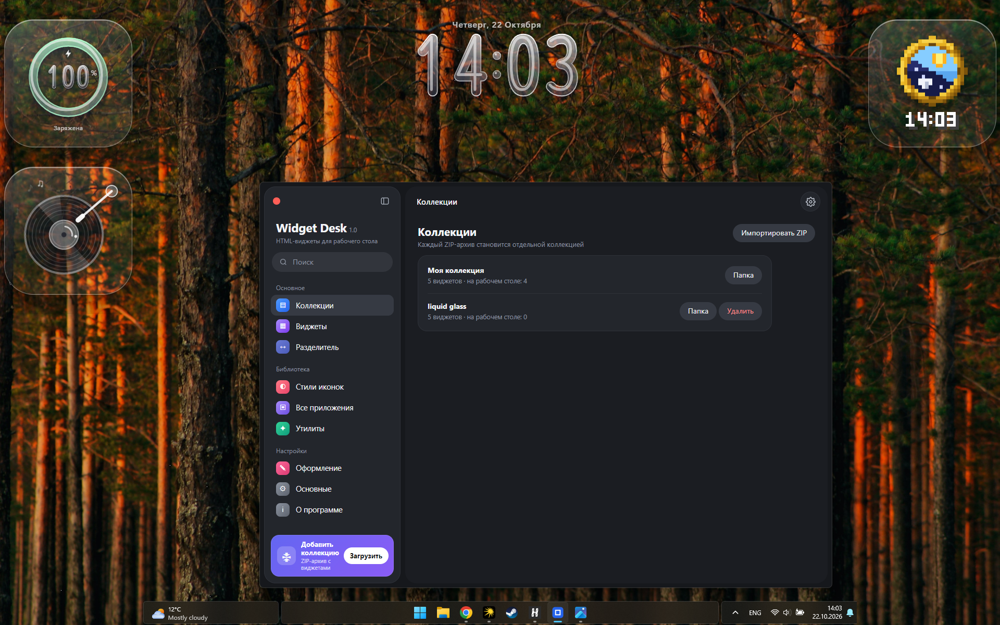

# Widget Desk

**Beautiful desktop widgets for Windows.**

Widget Desk — приложение для размещения HTML-виджетов на рабочем столе Windows. Оно позволяет собирать собственную коллекцию виджетов, закреплять их на рабочем столе и настраивать персональное пространство в стиле Liquid Glass.

  

  <strong>Personalize your desktop. Make it yours.</strong>

---

## ✨ Features

- **Desktop widgets** — размещайте виджеты непосредственно на рабочем столе.
- **Widget collections** — организуйте виджеты по коллекциям.
- **HTML widgets** — используйте HTML-виджеты для создания собственного оформления рабочего стола.
- **Pin widgets** — закрепляйте виджеты на рабочем столе.
- **ZIP import** — импортируйте коллекции виджетов из ZIP-архивов.
- **Widget library** — управляйте доступными виджетами из единого интерфейса.
- **Modern interface** — тёмный интерфейс с прозрачными элементами и плавным визуальным оформлением.
- **Customization** — создавайте собственное рабочее пространство с подходящими виджетами.

## 🧩 Included Widgets

Widget Desk includes a collection of desktop widgets:

| Widget | Description |
|---|---|
| **Glass Clock** | Часы с минималистичным стеклянным оформлением. |
| **Glass Battery** | Виджет уровня заряда батареи. |
| **Glass Vinyl** | Декоративный виниловый проигрыватель. |
| **Glass Moon** | Виджет с изображением Луны. |
| **Pixel Clock** | Часы в пиксельном стиле. |

Коллекция может расширяться новыми виджетами.

## 🖥️ Screenshots

### Desktop

Показывает виджеты на рабочем столе Windows.

### Widget Library

Управляйте виджетами, просматривайте коллекцию и выбирайте элементы для рабочего стола.

### Collections

Создавайте и организуйте собственные коллекции виджетов.

> Чтобы изображения отображались на GitHub, добавьте скриншоты в папку `screenshots` в репозитории и используйте соответствующие имена файлов.

## 📥 Installation

Способ установки зависит от доступного формата распространения проекта.

1. Откройте раздел **Releases** в репозитории GitHub.
2. Скачайте актуальную версию приложения, если опубликован готовый установочный файл.
3. Запустите приложение согласно инструкциям соответствующего релиза.

Если готового релиза пока нет, следуйте инструкциям по сборке из исходного кода, которые будут добавлены в репозиторий.

## 🛠️ Technology

Widget Desk uses HTML-based widgets for desktop customization.

Дополнительные сведения о языках программирования, фреймворках и инструментах сборки будут указаны здесь после уточнения состава проекта.

## 🗺️ Roadmap

Возможные направления дальнейшего развития:

- [ ] Новые оригинальные виджеты.
- [ ] Дополнительные стили оформления.
- [ ] Улучшение управления коллекциями.
- [ ] Больше возможностей настройки рабочего стола.
- [ ] Оптимизация производительности.
- [ ] Улучшение документации для разработчиков виджетов.

## 🤝 Contributing

Contributions, ideas, bug reports and suggestions are welcome.

Если вы хотите предложить новую функцию или сообщить об ошибке, создайте Issue в репозитории проекта.

Перед отправкой изменений ознакомьтесь с правилами проекта, если они опубликованы.

## 📄 License

Лицензия проекта пока не указана.

Перед публикацией репозитория выберите лицензию, например MIT, если хотите разрешить другим пользователям свободно использовать, изменять и распространять код на её условиях.

---

  <strong>Widget Desk</strong> 
  Your desktop. Your widgets. Your style.

